# Vampior Auth — Technical Documentation

A Flutter authentication app for **Vampior Designs**: onboarding, login, registration, password
reset, a signed-in screen and **auto-login**. It's built from the `Auth Flow v3` design
(visual spec: [`DESIGN.md`](DESIGN.md)) on a realistic token-based auth flow against a
**mock backend** that runs inside the app: access + refresh tokens, flutter_secure_storage,
silent refresh, rotation and revocation.

> Contributor and AI-assistant rules: [`CLAUDE.md`](CLAUDE.md) · Visual spec: [`DESIGN.md`](DESIGN.md)

## Contents

1. [Overview](#1-overview)
2. [Getting started](#2-getting-started)
3. [Project structure](#3-project-structure)
4. [Architecture](#4-architecture)
5. [Dependency injection](#5-dependency-injection)
6. [State management](#6-state-management)
7. [Navigation and launch flow](#7-navigation-and-launch-flow)
8. [Authentication and tokens](#8-authentication-and-tokens)
9. [Mock backend and API reference](#9-mock-backend-and-api-reference)
10. [Persistence](#10-persistence)
11. [Forms and validation](#11-forms-and-validation)
12. [UI components](#12-ui-components)
13. [Testing](#13-testing)
14. [Development guide](#14-development-guide)
15. [Troubleshooting](#15-troubleshooting)
16. [Screenshots and known limitations](#16-screenshots-and-known-limitations)

---

## 1. Overview

### Features

- **Onboarding**: three swipeable slides, shown on first launch only.
- **Login**: email or mobile, password with show/hide, Remember me, forgot password, a loading
  button.
- **Registration**: full name, email, `+94` mobile (formats as you type), password with a
  strength meter, confirm password.
- **Forgot password**: a reset link with a 30s resend cooldown.
- **Signed-in screen**: the profile from the protected `/auth/me` endpoint, a live
  access-token countdown, Refresh profile, and Log out (with a confirmation dialog).
- **Auto-login**: reopening the app restores the session from secure storage.
- **Token auth**: Bearer access token, silent refresh, refresh-token rotation, session expiry.
- **Responsive**: phone layout, plus a framed card on tablet and desktop; reduced motion is
  respected.

### Tech stack

| Concern | Choice |
|---|---|
| Framework | Flutter 3.47 · Dart 3.13 |
| State management | `provider` (a `ChangeNotifier` controller per screen) |
| Dependency injection | `get_it`, one module per layer/feature |
| Architecture | Clean Architecture, feature-first (`domain` / `data` / `presentation`) |
| Error handling | `dartz` `Either<Failure, T>`, `equatable` |
| HTTP | `dio` + custom interceptors |
| Secrets | `flutter_secure_storage` (Keychain / Android Keystore / libsecret / DPAPI) |
| Preferences | `shared_preferences` |
| Mock backend DB | `sqflite` (+ `sqflite_common_ffi` on desktop and in tests) |
| Crypto | `crypto` (HMAC-SHA256 tokens, salted SHA-256 passwords in the mock backend) |
| Testing | `flutter_test`, `mocktail` |

### Requirements checklist

| Requirement | Implementation |
|---|---|
| Email/mobile + password, show/hide, Remember me, forgot password, loading login button | `features/auth/presentation/pages/login_page.dart` |
| Full name, email, mobile, password + confirm, validation, register button | `register_page.dart` (+ `PhoneField`, strength meter) |
| Validation on every field | `core/validation/validators.dart` (pure, unit-tested) |
| Reusable UI components | `lib/shared/widgets/` ([§12](#12-ui-components)) |
| Proper navigation | named routes, startup router, cleared back stack ([§7](#7-navigation-and-launch-flow)) |
| Error and success messages | inline `StatusBanner`, top toast, Success screen, confirm dialog |
| API scenarios (mock acceptable) | 200/201/204/401/404/409/422/500 + offline ([§9](#9-mock-backend-and-api-reference)) |
| Provider; UI / models / services / controllers separated | [§4](#4-architecture), [§6](#6-state-management) |
| Works on different screen sizes, no overflow | `ResponsiveFrame`; tests at 320×568 and 1280×800 |
| Runs without critical errors | `flutter analyze` clean; 95 tests green |
| Screenshots | [`screenshots/`](screenshots), [§16](#16-screenshots-and-known-limitations) |

---

## 2. Getting started

### Prerequisites

- Flutter **3.47+** / Dart **3.13+**. Check with `flutter --version`.
- A target device: Android emulator or phone (minSdk 24), iOS simulator, macOS, Windows or Linux.
- **Linux desktop only:** `sudo apt install libsecret-1-dev` (for flutter_secure_storage).
- No backend, API keys or `.env` file are needed.

### Clone, install, run

```bash
git clone https://github.com/arshvinw5/vampiordesign.git
cd vampiordesign
flutter pub get

flutter devices                 # list targets
flutter run -d <device-id>      # e.g. emulator-5554, linux, macos
```

### Demo account

On first launch the app creates the local database and seeds this account:

| Field | Value |
|---|---|
| Email | `demo@vampior.com` |
| or mobile | `0771234567` (also `+94 77 123 4567` / `771234567`) |
| Password | `demo1234` |

### Walkthrough

1. **First launch → Onboarding.** Swipe through it, or tap **Skip** or **Get started**. The
   app never shows onboarding again.
2. **Log in** with the demo account (Remember me is on by default). The button shows
   *Logging in…* for about 1.5s, the simulated network delay.
3. **Signed-in screen.** Name, Email and Mobile come from the protected `GET /auth/me`
   endpoint. *Access token: Expires in 59s* counts down.
4. **Close the app completely and reopen it.** A short *Checking your session…* screen
   appears, then you're **signed in again** without entering anything (auto-login).
5. **Wait more than 60s, then tap Refresh profile (or reopen the app).** The access token has
   expired, so the app silently refreshes it (`/auth/me` → `/auth/refresh` 200 → `/auth/me`
   200, visible in the `flutter run` console).
6. **Log out.** A dialog asks *Log out?*. **Stay signed in** cancels; **Log out** revokes the
   session on the server and wipes secure storage. Reopening the app now shows **Login**.
7. Log in with **Remember me off**, then reopen the app: it shows **Login** (no auto-login),
   because the user chose not to stay signed in.
8. To make your own account, tap **Create one**. It's saved in the local SQLite database
   and survives restarts.

### Try the error scenarios

| Input | Result |
|---|---|
| Wrong password or unknown user | 401 → "Incorrect email/mobile or password" |
| Register an existing email or mobile | 409 → "Email already registered" / "Mobile number already registered" |
| Forgot password for an unknown user | 404 → "No account found…" |
| Any identifier starting with `network@` | connection error → "No connection…" |
| Any identifier starting with `server@` | 500 → "Something went wrong on our side…" |

### Reset app data

```bash
adb shell pm clear com.example.vampiordesigns        # Android
rm -rf ~/.local/share/com.example.vampiordesigns     # Linux (database)
```

---

## 3. Project structure

```
lib/
├─ main.dart                      configureDependencies() → runApp(VampiorApp)
├─ app.dart                       MaterialApp; initialRoute '/'; listens for "session expired"
├─ core/                          shared kernel (no feature logic)
│  ├─ auth/                       AuthTokens (+ Clock), SessionEvents
│  ├─ di/                         service_locator.dart (sl, DependencyOverrides),
│  │                              core_module.dart, network_module.dart
│  ├─ error/                      sealed Failure hierarchy, CacheException
│  ├─ network/                    ApiEndpoints, DioClient, AuthInterceptor, DioErrorMapper
│  ├─ presentation/               FormController (loading / failure / submitted)
│  ├─ router/                     AppRoutes, SuccessArgs, AppRouter, FadeSlidePageRoute
│  ├─ storage/                    TokenStorage (secure), PreferencesDataSource (prefs)
│  ├─ theme/                      AppColors, AppTextStyles, AppMotion, AppTheme
│  ├─ usecase/                    UseCase<T, P>, NoParams
│  ├─ utils/                      LkMobile (+94 parse/format), PasswordStrength
│  └─ validation/                 Validators
├─ features/
│  ├─ auth/
│  │  ├─ domain/                  entities: User, AuthSession
│  │  │                           repositories: AuthRepository (interface)
│  │  │                           usecases: LoginUser, RegisterUser, RequestPasswordReset,
│  │  │                             GetRememberedIdentifier, GetCurrentSession,
│  │  │                             RestoreSession, LogoutUser
│  │  ├─ data/                    models: UserModel, AuthResponseModel, request DTOs
│  │  │                           datasources: AuthRemoteDataSource (Dio)
│  │  │                           repositories: AuthRepositoryImpl
│  │  ├─ presentation/            controllers: Login, Register, ForgotPassword, Home
│  │  │                           pages: login, register, forgot_password, success
│  │  │                           widgets: AuthScaffold, RememberForgotRow, SuccessBadge
│  │  └─ di/auth_module.dart
│  ├─ onboarding/                 domain (repo + CheckOnboardingSeen, CompleteOnboarding),
│  │                              data, presentation, di
│  └─ startup/                    StartupController + StartupPage (launch routing), di
├─ shared/widgets/                design-system UI kit (§12)
└─ mock_backend/                  the "server", kept separate from the app
   ├─ database/app_database.dart  SQLite schema v2 + migrations + seed
   ├─ stores/                     UserStore, SessionStore (SQLite implementations)
   ├─ models/                     UserRecord, SessionRecord
   ├─ security/                   MockTokenService (HS256), PasswordHasher
   ├─ mock_auth_server.dart       endpoint logic
   ├─ mock_api_interceptor.dart   routes Dio requests to the server
   └─ mock_backend_module.dart    DI registration
test/                             unit + widget tests (§13)
screenshot_test/                  headless screenshot renderer
assets/fonts/                     Archivo 400/700 (bundled)
```

---

## 4. Architecture

### Layers and the dependency rule

```
 ┌───────────────────── presentation ─────────────────────┐
 │ Pages (widgets) ──context.watch/read──▶ Controllers     │  Flutter + Provider
 └──────────────────────────┬─────────────────────────────┘
                            │ calls
 ┌──────────────────────── domain ────────────────────────┐
 │ Use cases ──▶ Repository interfaces · Entities          │  pure Dart, Either<Failure,T>
 └──────────────────────────▲─────────────────────────────┘
                            │ implements
 ┌───────────────────────── data ─────────────────────────┐
 │ Repository impls ──▶ Data sources ──▶ Dio / storage     │  JSON models, exceptions
 └────────────────────────────────────────────────────────┘
```

- Dependencies point **inward**: presentation → domain ← data. Domain imports no Flutter, Dio
  or storage code, only `core` primitives (`Failure`, `UseCase`, `AuthTokens`).
- The app reaches `mock_backend/` **only through HTTP-shaped Dio calls**. Only the DI root
  imports it, so a real API can replace it ([§5](#5-dependency-injection)).

### Request lifecycle (login)

```
LoginPage._submit()
  → LoginController.login()                       (FormController.run: loading → result)
    → LoginUser(params)                           (domain use case)
      → AuthRepositoryImpl.login()                (data)
        → AuthRemoteDataSource.login()            POST /auth/login (public)
          → Dio → LogInterceptor → AuthInterceptor (public: pass) → MockApiInterceptor
            → MockAuthServer._login() → UserStore + SessionStore (SQLite)
        ← AuthResponseModel {user, tokens}
        → TokenStorage.save(tokens)               (flutter_secure_storage)
      ← Right(AuthSession)
      → setRememberedIdentifier / setKeepSignedIn (shared_preferences)
  ← controller notifies → page navigates to /success
```

### Error handling

| Layer | Behaviour |
|---|---|
| Data sources | throw `DioException` (HTTP) or `CacheException` (storage) |
| Repositories | catch **everything** and return `Left(Failure)`; `DioErrorMapper` maps HTTP status to a failure |
| Use cases / controllers | pass along or `fold` the `Either`; controllers expose `failure` / `errorMessage` |
| UI | renders `StatusBanner` / toasts; never catches exceptions |

`Failure` is a sealed class: `NetworkFailure`, `ServerFailure`, `InvalidCredentialsFailure`,
`UserNotFoundFailure`, `ConflictFailure`, `CacheFailure`, `SessionExpiredFailure`.

---

## 5. Dependency injection

`get_it` service locator (`sl`) in `lib/core/di/service_locator.dart`.
`configureDependencies([DependencyOverrides])` registers the modules **in order**:

| # | Module | Registers |
|---|---|---|
| 1 | `core/di/core_module.dart` | `Clock`, `SharedPreferences`, `PreferencesDataSource`, `TokenStorage` → `SecureTokenStorage`, `SessionEvents` |
| 2 | `mock_backend/mock_backend_module.dart` | `AppDatabase`, `UserStore`, `SessionStore`, `MockTokenService`, `MockAuthServer`, transport `Interceptor` (`MockApiInterceptor`) |
| 3 | `core/di/network_module.dart` | bare `Dio` (refresh/retry), `AuthInterceptor`, main `Dio` |
| 4 | `features/onboarding/di/onboarding_module.dart` | `OnboardingRepository`, `CheckOnboardingSeen`, `CompleteOnboarding`, `OnboardingController`* |
| 5 | `features/auth/di/auth_module.dart` | `AuthRemoteDataSource`, `AuthRepository`, 7 use cases, `Login/Register/ForgotPassword/HomeController`* |
| 6 | `features/startup/di/startup_module.dart` | `StartupController`* |

\* **factory**: a fresh instance per screen. Everything else is a (lazy) singleton.

- `AppRouter` is the only presentation code that touches `sl`. It wraps each page in
  `ChangeNotifierProvider(create: (_) => sl<Controller>())`, so Provider disposes the
  controller when the route is popped.
- **`DependencyOverrides`** (tests and demos): `prefs`, `tokenStorage`, `userStore`,
  `sessionStore`, `apiLatency`, `accessTokenTtl`, `clock`. `resetDependencies()` disposes
  everything (closes the DB and streams).
- **Swap to a real API:** delete `registerMockBackendModule(...)` in `configureDependencies`
  and set `ApiEndpoints.baseUrl`. With no transport interceptor registered, Dio makes real
  HTTP calls. No feature code changes.

---

## 6. State management

Provider with one `ChangeNotifier` per screen, created by DI and scoped to the route.

| Controller | Screen | State |
|---|---|---|
| `LoginController` | Login | `FormController` + `rememberMe`, `initialIdentifier` |
| `RegisterController` | Register | `FormController` |
| `ForgotPasswordController` | Forgot password | `FormController` + `sentTo`, `cooldown` (30s timer) |
| `HomeController` | Signed in | `session`, `failure`, `accessSecondsLeft` (1s ticker), `loggingOut` |
| `OnboardingController` | Onboarding | slide `index` |
| `StartupController` | Startup | memoized `decide()` → `StartupDecision` |

**`FormController`** (`core/presentation/form_controller.dart`) is the base for forms:

```
idle ──run()──▶ loading ──Right──▶ success
                        └─Left───▶ failure (errorMessage)
```

- `run()` ignores re-entry while loading (no double submits) and is safe after dispose.
- `submitted` flips on the first submit attempt, so every field shows its errors from then on.

Widgets use `context.watch<T>()` to rebuild and `context.read<T>()` inside callbacks.

---

## 7. Navigation and launch flow

### Routes

| Route | Page | Controller |
|---|---|---|
| `/` | `StartupPage` (launch screen) | `StartupController` |
| `/onboarding` | `OnboardingPage` | `OnboardingController` |
| `/login` | `LoginPage` (also the fallback for unknown routes) | `LoginController` |
| `/register` | `RegisterPage` | `RegisterController` |
| `/forgot-password` | `ForgotPasswordPage` (arg: prefilled identifier) | `ForgotPasswordController` |
| `/success` | `SuccessPage` (arg: `SuccessArgs`) | `HomeController` |

- Transition: fade + 24px horizontal slide, 260ms ease-out (fade only with reduced motion).
- Back stack: Login → Register / Forgot use `pushNamed` (Back returns). Startup → anything,
  Onboarding → Login, Login/Register → Success, and Log out → Login use
  `pushNamedAndRemoveUntil`, so Back can never return into a finished flow. Success also
  blocks system Back (`PopScope`).

### Launch decision (auto-login)

```
App start ─▶ "/" StartupPage ("Checking your session…")
  │
  ├─ onboarding not seen (prefs) ─────────────────────────────▶ /onboarding
  │
  └─ RestoreSession
       ├─ no tokens in secure storage ────────────────────────▶ /login
       ├─ keepSignedIn == false (Remember me was off)
       │      → clear tokens ──────────────────────────────────▶ /login
       └─ GET /auth/me (AuthInterceptor refreshes if expired)
              ├─ 200 ──────────────────────────────────────────▶ /success  "still signed in"
              ├─ refresh rejected / revoked (SessionExpired)
              │      → tokens cleared ─────────────────────────▶ /login
              └─ offline / 5xx ─────────────────────────────────▶ /success  (tokens still valid;
                                                                   Home shows error + Refresh)
```

The onboarding flag (`vampior.onboardingSeen`) is written by **Skip** or **Get started**
through the `CompleteOnboarding` use case.

---

## 8. Authentication and tokens

### Token model

| Token | Format | Lifetime | Stored (client) | Stored (server) |
|---|---|---|---|---|
| Access | JWT-shaped `header.payload.signature`, HMAC-SHA256, claims `sub`, `iat`, `exp` | **60s** | secure storage | — (stateless, verified by signature) |
| Refresh | 32 random bytes, base64url | **7 days**, rotated on every use | secure storage | `sessions` table (revocable) |

`AuthTokens` (`core/auth/auth_tokens.dart`) holds both tokens and `accessExpiresAt`. It
counts the access token as expired **10s early** (`expirySkew`), so tokens don't expire in
flight.

### Flow

```
App                           AuthInterceptor (QueuedInterceptor)        Mock backend
 │ POST /auth/login (public) ─────────────────────────────────────────▶ verify password
 │ ◀────────── 200 {user, accessToken, refreshToken, tokenType, expiresIn: 60}
 │ TokenStorage.save()  (flutter_secure_storage)
 │
 │ GET /auth/me ───────▶ expires within 10s?
 │                       ├─ no ──▶ Authorization: Bearer <access> ─────▶ 200 {user}
 │                       └─ yes ─▶ POST /auth/refresh {refreshToken} ─▶ revoke old, issue new
 │                                 save new pair, then send /auth/me with the new token
 │
 │ server answers 401 anyway (e.g. clock skew)
 │                       ├─ the rejected token is still the stored one → refresh once
 │                       ├─ another request already refreshed → just retry with the new token
 │                       └─ retry once (marked so it never loops) ─────▶ 200
 │                       Requests are queued, so N parallel 401s cause ONE refresh.
 │
 │ refresh rejected (401: revoked / expired / replayed)
 │                       clear tokens → SessionEvents.sessionExpired()
 │ ◀── VampiorApp: go to /login + toast "Session expired, please log in again"
 │
 │ Log out (after the confirm dialog)
 │ POST /auth/logout {refreshToken} ──────────────────────────────────▶ revoke (204)
 │ TokenStorage.clear()  (even if offline)
```

- Requests flagged `Options(extra: ApiEndpoints.publicRequest)` skip the interceptor (login,
  register, refresh, logout, forgot-password).
- Refresh and retry go through a **separate bare Dio** (no AuthInterceptor). This avoids
  deadlocking the queue and recursion.
- A **network error** during refresh keeps the session (the user may simply be offline). Only
  a definite 401 ends it.

### Security notes

- Tokens live only in flutter_secure_storage: Keychain (`first_unlock_this_device`, not
  backed up), Android Keystore-backed encryption, libsecret, DPAPI. They're never put in
  shared_preferences or SQLite on the client. This was checked on Android: the values on disk
  are ciphertext.
- Refresh-token **rotation** plus **replay rejection**: a stolen, already-used refresh token
  stops working.
- Logout revokes server-side, and the user must confirm it first.
- The mock backend's signing secret and password salt are constants in the app. That's fine
  for a demo; a real backend keeps secrets server-side and uses a slow KDF (bcrypt/argon2).

---

## 9. Mock backend and API reference

Base URL `https://api.vampior.mock/v1`, never actually contacted: `MockApiInterceptor`
answers every request from `MockAuthServer` after **1.5s** of simulated latency, and returns
real `Response` / `DioException` objects. So the app's code path is the same as with a real
server.

| Method | Path | Auth | Success | Errors |
|---|---|---|---|---|
| POST | `/auth/login` | public | **200** user + tokens | 401 bad credentials · 422 missing fields |
| POST | `/auth/register` | public | **201** user + tokens | 409 duplicate email/mobile |
| POST | `/auth/refresh` | public (body) | **200** new pair (old revoked) | 401 unknown / revoked / expired |
| POST | `/auth/logout` | public (body) | **204** (revokes) | — |
| POST | `/auth/forgot-password` | public | **200** | 404 unknown user |
| GET | `/auth/me` | Bearer | **200** user | 401 missing / invalid / expired token |

**Examples**

```http
POST /auth/login
{"identifier": "demo@vampior.com", "password": "demo1234"}

200 OK
{
  "user": {"id": 1, "fullName": "Demo User", "email": "demo@vampior.com",
           "mobile": "771234567", "createdAt": "2026-11-02T07:58:00.000Z"},
  "accessToken": "eyJhbGciOiJIUzI1NiIsInR5cCI6IkpXVCJ9.eyJzdWIiOjEsImlhdCI6…",
  "refreshToken": "q3V9…",
  "tokenType": "Bearer",
  "expiresIn": 60
}
```

```http
POST /auth/register
{"fullName": "Jane Doe", "email": "jane@doe.com", "mobile": "712345678", "password": "abcdefg1"}

409 Conflict
{"message": "Email already registered", "field": "email"}
```

```http
GET /auth/me
Authorization: Bearer <expired token>

401 Unauthorized
{"message": "Access token expired"}
```

Errors always look like `{"message": "..."}`; the app shows `message` to the user.

**Fault hooks (demo):** an `identifier` or `email` starting with `network@` throws a
connection error; one starting with `server@` returns 500.

**Database** (`mock_backend/database/app_database.dart`, file `vampior.db`):

```sql
-- v1
CREATE TABLE users (
  id INTEGER PRIMARY KEY AUTOINCREMENT,
  full_name TEXT NOT NULL,
  email TEXT NOT NULL UNIQUE COLLATE NOCASE,
  mobile TEXT NOT NULL UNIQUE,            -- 9 national digits, e.g. 771234567
  password_hash TEXT NOT NULL,            -- salted SHA-256 (mock only)
  created_at TEXT NOT NULL
);
-- v2
CREATE TABLE sessions (
  refresh_token TEXT PRIMARY KEY,
  user_id INTEGER NOT NULL REFERENCES users(id) ON DELETE CASCADE,
  expires_at TEXT NOT NULL,
  revoked INTEGER NOT NULL DEFAULT 0,
  created_at TEXT NOT NULL
);
```

**Migrations:** bump `AppDatabase.version`, add an `if (from < N)` step in `_onUpgrade`, and
add a test (see the v1 → v2 test in `test/mock_backend/backend_test.dart`).

---

## 10. Persistence

| Data | Storage | Key / table | Why there |
|---|---|---|---|
| Access token, refresh token, access expiry | flutter_secure_storage | `vampior.accessToken`, `vampior.refreshToken`, `vampior.accessExpiresAt` | secrets: OS-level encryption |
| Onboarding seen | shared_preferences | `vampior.onboardingSeen` | non-secret flag, read at launch |
| Remembered identifier | shared_preferences | `vampior.rememberedId` | prefill Login (Remember me) |
| Stay signed in | shared_preferences | `vampior.keepSignedIn` | allows auto-login (Remember me) |
| Users, refresh sessions | SQLite (mock backend) | `users`, `sessions` | server-side data |

Database location: the sqflite default on mobile; the app-support directory on desktop
(e.g. `~/.local/share/com.example.vampiordesigns/`).

---

## 11. Forms and validation

| Field | Rule | Message |
|---|---|---|
| Email or mobile (login, reset) | required; valid email or 9–15 digits | Enter a valid email or mobile number |
| Password (login) | required; ≥ 6 chars | Password must be at least 6 characters |
| Full name | letters only; first + last | Enter first and last name |
| Email | valid format | Enter a valid email address |
| Mobile (+94) | 9 digits starting with 7 | Enter a 9-digit number starting with 7 |
| Password (register) | ≥ 8; letters + a number | Use letters and at least one number |
| Confirm password | equals password | Passwords do not match |

- Validators are pure functions returning `String?` (`core/validation/validators.dart`).
- **When errors show:** after a field loses focus with content, or on every field after the
  first submit (`forceValidation: controller.submitted`). They then update live as you type.
- **Invalid submit:** the form shakes (−6/5/−3px, 280ms) and the first invalid field gets
  focus.
- Each field reserves its message row, so the layout never jumps.
- Keyboard: correct input types, **Next** between fields, **Go** on the last field submits,
  and autofill hints (username, password, new-password, name, email, tel).
- Password strength meter: 4 segments (length ≥ 8, mixed case, digit, symbol) → Weak / Fair /
  Good / Strong.

---

## 12. UI components

All in `lib/shared/widgets/`, screen-agnostic, styled from `core/theme` tokens.

| Component | Purpose |
|---|---|
| `AppTextField` | label above, leading icon or fixed prefix, state borders (idle/focus/valid/error) + focus ring, valid check, eye toggle (`obscurable`), reserved message row |
| **`PhoneField`** | prebuilt `+94` mobile input (below) |
| `PrimaryButton` | loading crossfade + spinner without resizing; `destructive` (red); `expand: false` hugs its label; custom `icon` |
| `SecondaryButton` | outlined navy button |
| `AppTextLink` | 14/700 link, 44px tap target |
| **`showConfirmDialog` / `AppConfirmDialog`** | common confirmation dialog (below) |
| `StatusBanner` | inline success/error notice (form errors, "reset link sent") |
| `AppSnackbar` | toast pinned to the **top**, so it never covers the bottom CTA bar |
| `PasswordStrengthMeter` | 4-segment strength bar |
| `Shake`, `Pressable` | invalid-submit shake; hover + 0.97 press scale |
| `ResponsiveFrame`, `AppTopBar` | full-bleed on phones, framed 400px card at ≥600px; 64px top bar |

Feature-level: `AuthScaffold` (top bar, scrollable title and fields, CTA pinned in the thumb
zone), `RememberForgotRow`, `SuccessBadge`.

### `PhoneField`: prebuilt phone number input

Phone numbers are the input users get wrong most often (country codes, leading zeros, spaces,
pasted numbers), so the app uses **one ready-made component** instead of a plain text box:

- fixed, non-editable `+94` prefix;
- formats as you type or paste: `0771234567`, `+94771234567` and `77 123 4567` all become
  `77 123 4567`;
- phone keyboard, `telephoneNumberNational` autofill, 9-digit cap;
- built-in validation, which can be overridden;
- `PhoneField.digitsOf(controller)` returns `771234567` for the API, and
  `LkMobile.international()` returns `+94 77 123 4567` for display.

```dart
PhoneField(controller: _mobile, forceValidation: controller.submitted);
// …
mobileDigits: PhoneField.digitsOf(_mobile),
```

### `showConfirmDialog`: common confirmation dialog

```dart
final ok = await showConfirmDialog(
  context,
  title: 'Log out?',
  message: 'Your session will end on this device and you will need to sign in again.',
  confirmLabel: 'Log out',
  cancelLabel: 'Stay signed in',
  destructive: true,
  icon: Icons.logout,
);
if (ok) await homeController.logout();
```

It returns `true` only on confirm (Cancel, tapping outside or system Back return `false`).
It has a white card, 2px navy frame, and stacked full-width actions in the thumb zone. It fades
and scales in over 260ms. Test keys: `dialog.confirm`, `dialog.cancel`.

### Theming, responsiveness, motion

- **Colour:** navy `#023E8A`, blue `#0096C7`, sky `#48CAE4`, pale `#ADE8F4`, ice `#CAF0F8`,
  ink `#0B1D33`, error `#C62828`. **Type:** Archivo 400/700 (bundled in `assets/fonts`).
  **Spacing:** 8pt grid, 24px gutters. **Radius:** 8 on inputs and buttons.
- **Responsive:** phones are full-bleed; at width ≥ 600 and height ≥ 640 the app sits in a
  framed card. Every screen scrolls and the CTA stays pinned. The onboarding controls measure
  their label and stack on narrow screens or with large text.
- **Motion:** ease-out `cubic(.23,1,.32,1)`, press scale 0.97, screen transitions 260ms.
  `MediaQuery.disableAnimations` removes movement and blur but keeps fades.

---

## 13. Testing

```bash
flutter test                    # 95 unit + widget tests
flutter test screenshot_test    # renders screenshots/*.png with the real fonts
flutter analyze
```

| File | Covers |
|---|---|
| `test/core/validators_test.dart` | every validator, +94 parsing/formatting, password strength |
| `test/core/auth_flow_test.dart` | real Dio + AuthInterceptor + repository against the real mock server: tokens saved on login/register, pre-emptive refresh + rotation, 401 refresh-and-retry (clock skew), **one refresh for parallel 401s**, revoked session → cleared + event, **restoreSession** branches, logout online/offline, SecureTokenStorage, DioErrorMapper, expiry skew |
| `test/mock_backend/backend_test.dart` | SQLite stores, **v1 → v2 migration**, token signing/expiry/tampering, every endpoint, refresh replay rejection, fault hooks |
| `test/features/auth/usecases_controllers_test.dart` | use cases (mocktail): Remember me → identifier + keepSignedIn; controller state transitions; forgot-password cooldown |
| `test/widgets/app_flow_test.dart` | **launch/auto-login** (first launch, relaunch signed in, Remember me off, revoked while closed, logout → relaunch), onboarding, login/register/forgot flows, show/hide, API errors, `/auth/me` on Success, logout dialog (cancel vs confirm), session-expired redirect, onboarding button sizing, no overflow at 320×568 / 1280×800 |

**Test infrastructure** (`test/helpers/`):
- `fakes.dart`: `FakeUserStore`, `FakeSessionStore`, `InMemoryTokenStorage`, `TestClock`.
  Widget tests can't run real sqflite I/O inside fake async, so they use these. Data tests use
  `sqflite_common_ffi` with an in-memory DB.
- `app_harness.dart`: `pumpVampiorApp(tester, …)` wires the **real DI graph** with the fakes
  and pumps the app. Use it with `tearDown(resetDependencies)`. Passing the same fakes again
  simulates an app restart.
- Widgets are found by key, e.g. `login.submit`, `register.mobile`, `success.logout`,
  `dialog.confirm`, `onboarding.next`.

---

## 14. Development guide

- **Style:** `flutter_lints`; format with `dart format -l 100 lib test screenshot_test`;
  `flutter analyze` must be clean. Private named initializing formals
  (`required this._repo`) are used deliberately.
- **Conventions:** one use case per action; repositories return `Either`; controllers are
  factories; UI uses the shared widgets and theme tokens (no raw colours); risky actions go
  through `showConfirmDialog`; phone numbers use `PhoneField`.

**Add a screen**

1. `features/<f>/presentation/controllers/<x>_controller.dart` (extend `FormController` for forms).
2. `presentation/pages/<x>_page.dart`, using `AuthScaffold` or `ResponsiveFrame`.
3. Register the controller with `registerFactory` in `features/<f>/di/<f>_module.dart`, and
   call the module from `configureDependencies`.
4. Add the route in `AppRoutes` and `AppRouter.onGenerateRoute`
   (`_scoped<XController>(const XPage())`).
5. Add a widget test with `pumpVampiorApp`.

**Add an endpoint**

1. Add the path to `ApiEndpoints` (mark it public if it needs no token).
2. Data source method + request/response models; repository method returning `Either`.
3. A use case in `domain/usecases`, registered in the feature module.
4. Mock it in `MockAuthServer.handle` (or the real backend), and add a test in `backend_test.dart`.

---

## 15. Troubleshooting

| Problem | Fix |
|---|---|
| Linux build fails: `libsecret-1` not found | `sudo apt install libsecret-1-dev` |
| `flutter run -d chrome` fails | Web isn't supported (sqflite has no web backend) |
| Emulator missing from `flutter devices` | `flutter emulators --launch <id>`, then `adb devices` |
| Want first-launch onboarding again | Reset app data ([§2](#reset-app-data)) or tap **Replay onboarding** |
| Stuck signed in during testing | Log out, or reset app data |
| Adding `google_fonts` breaks the build on Flutter 3.47 | It returns `material_ui` types that clash with `flutter/material`; Archivo is bundled in `assets/fonts` instead |
| Widget test hangs in `pumpAndSettle` | something animates forever; spinners must be hidden or wrapped in `TickerMode(enabled: false)` when idle |

---

## 16. Screenshots and known limitations

Rendered by `flutter test screenshot_test` with the real fonts. The headless renderer draws
shadows without blur; on a device they look soft.

| | | |
|---|---|---|
| 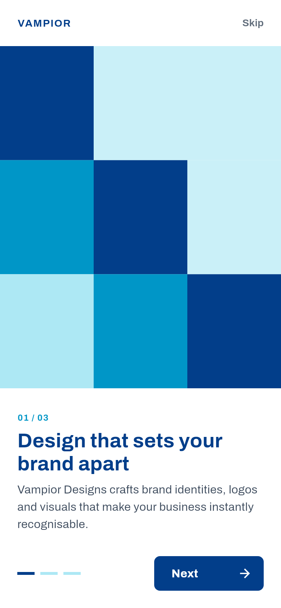 Onboarding | 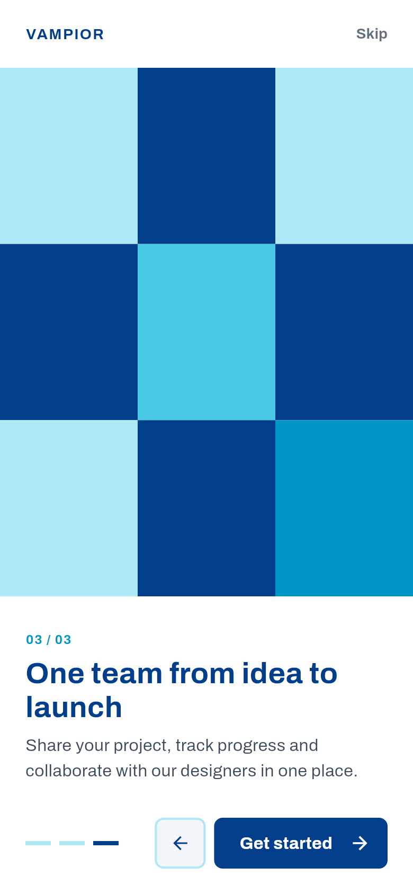 Get started | 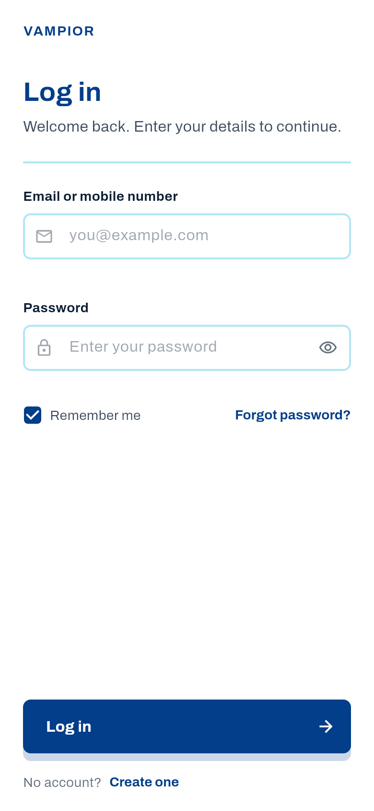 Login |
| 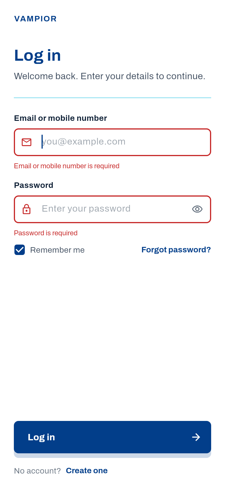 Validation | 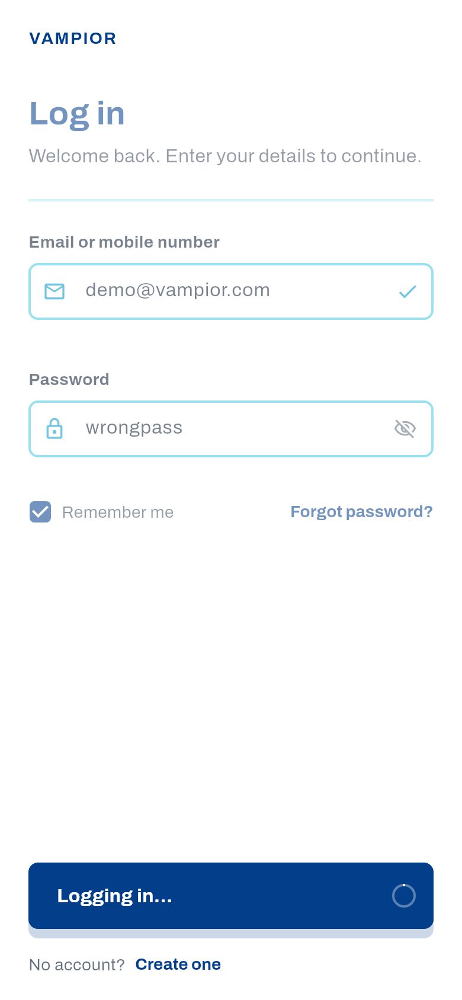 Loading | 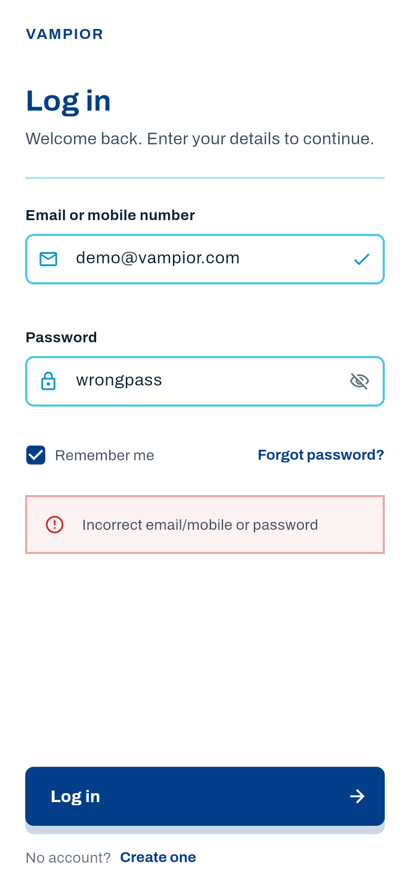 API error |
| 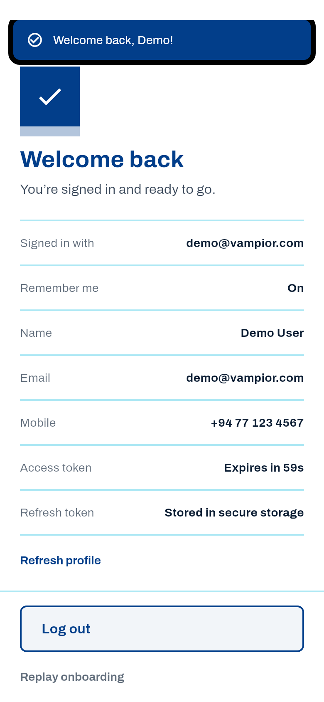 Signed in (`/auth/me`) | 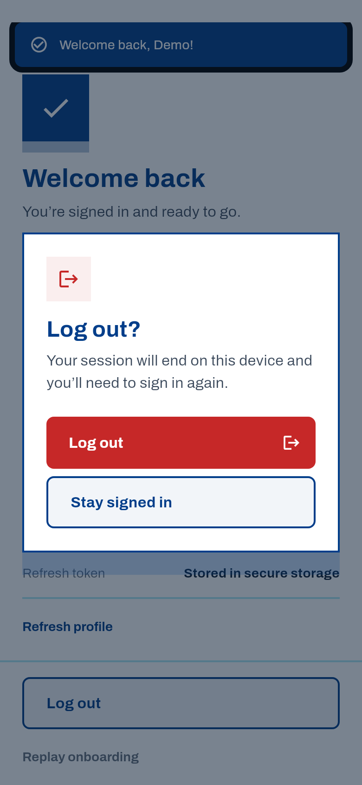 Log out confirmation | 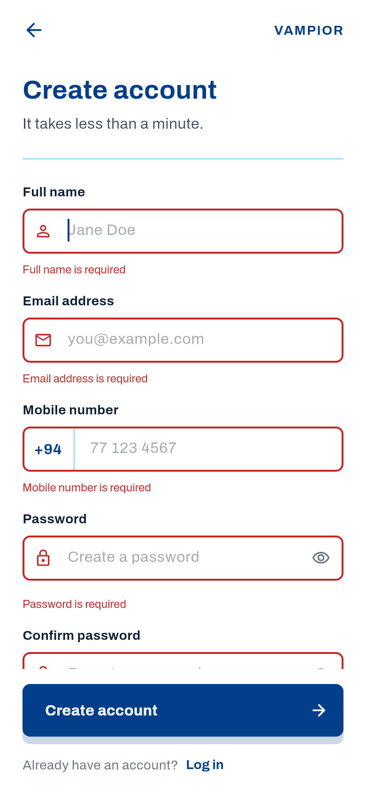 Register errors |
| 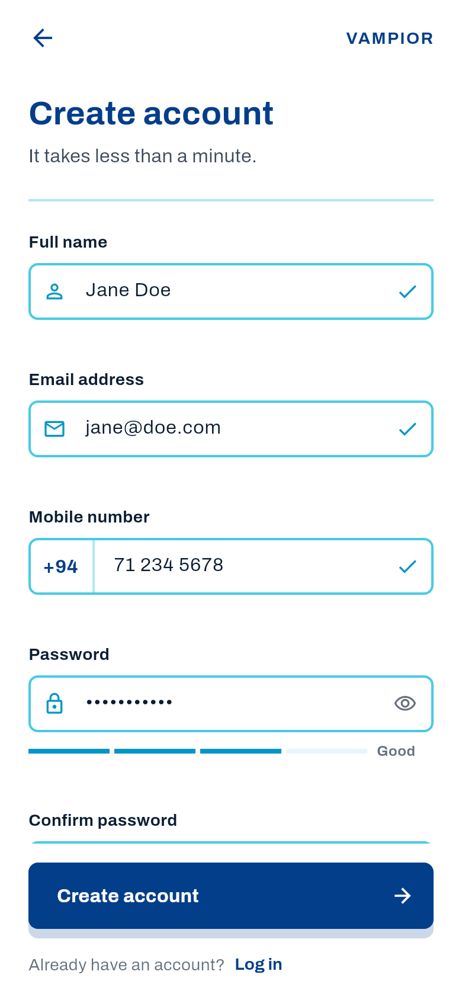 Register (+94 PhoneField) | 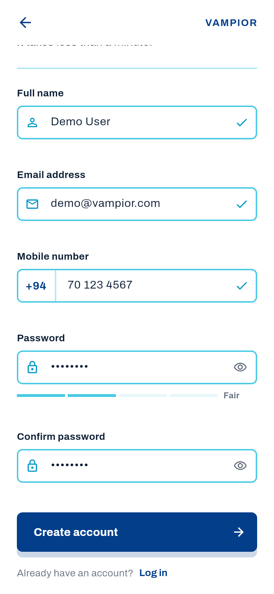 Duplicate email | 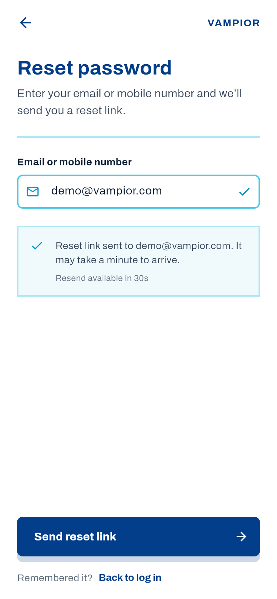 Reset sent |
| 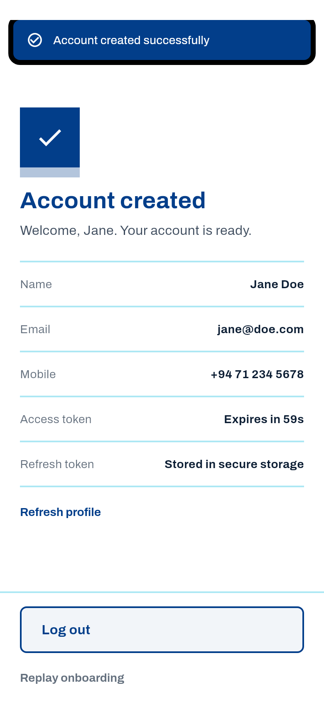 Account created | 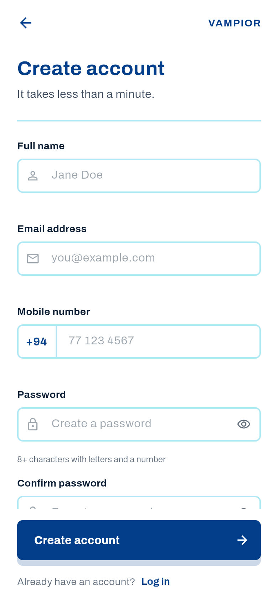 Register | 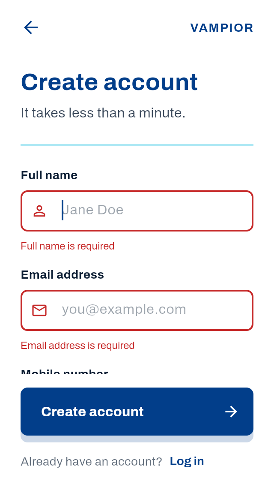 320×568 |

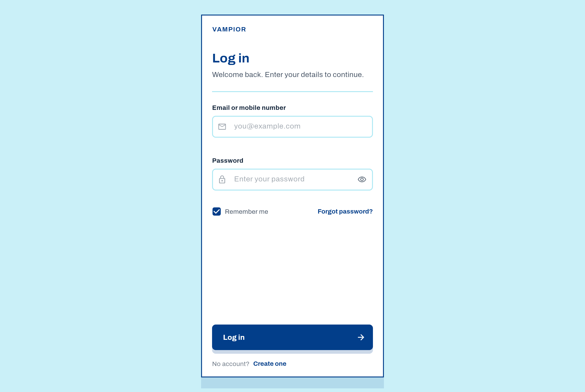

**Known limitations**

- The mock backend runs inside the app; its signing secret is a constant (demo only).
- No web build (sqflite).
- The design's Caps Lock warning isn't implemented.
